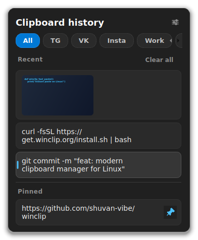
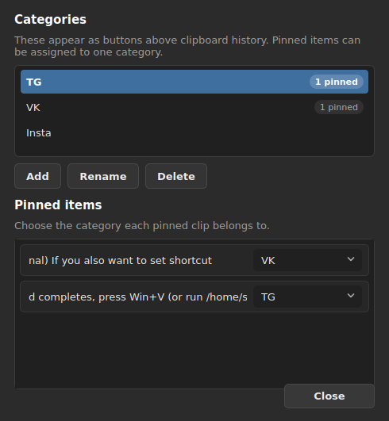

# WinClip 📋 — Windows 11 Clipboard History for Linux (Win+V)

[](https://www.python.org/)
[](https://riverbankcomputing.com/software/pyqt/)
[-FCC624?style=for-the-badge&logo=linux&logoColor=black)](https://www.kernel.org/)
[](LICENSE)

**WinClip** is a lightweight, modern, and high-performance **Windows 11 clipboard history alternative for Linux**.

Designed for Linux users who miss the effortless <kbd>Win</kbd> + <kbd>V</kbd> workflow, WinClip brings the exact minimalist Windows 11 Fluent dark aesthetic, instant paste capability, category organization, image thumbnails, and pinned clips directly to your Linux desktop.

<p align="center">
  
  &nbsp;&nbsp;&nbsp;&nbsp;
  
</p>

---

## 💡 Why WinClip?

If you switched from Windows 11 to Linux (Linux Mint, Ubuntu, Debian, Arch, Fedora), you likely missed pressing <kbd>Win</kbd> + <kbd>V</kbd> to view clipboard history and paste previous items.

Traditional Linux clipboard managers (like CopyQ or GPaste) often feature clunky multi-tab desktop interfaces or lack modern styling. **WinClip** was built from scratch to solve this:
1. **True Windows 11 Aesthetic**: Dark theme, rounded cards, subtle drop shadow, and centered cursor positioning.
2. **Zero Idle CPU**: Purely event-driven through native Qt signals (`QClipboard.dataChanged`). No polling loops, no battery drain.
3. **Smart Terminal Pasting**: Automatically detects terminal emulators and injects <kbd>Ctrl</kbd> + <kbd>Shift</kbd> + <kbd>V</kbd> instead of <kbd>Ctrl</kbd> + <kbd>V</kbd>.
4. **Organized Categories**: Group your pinned clips into custom categories (e.g. *Work*, *Templates*, *Social*).

---

## 📊 Feature Comparison

| Feature | WinClip | Windows 11 Native | CopyQ | GPaste / Diodon |
| :--- | :---: | :---: | :---: | :---: |
| **Windows 11 Fluent Dark UI** | ✅ | ✅ | ❌ | ❌ |
| **Native <kbd>Win</kbd>+<kbd>V</kbd> Clipboard History** | ✅ | ✅ | ⚠️ *Configurable* | ⚠️ *Configurable* |
| **Native <kbd>Win</kbd>+<kbd>Shift</kbd>+<kbd>S</kbd> Screen Snip** | ✅ | ✅ | ❌ | ❌ |
| **0% Idle CPU (Event-Driven)** | ✅ | ✅ | ⚠️ *Heavy* | ✅ |
| **Window & Region Screen Capture** | ✅ | ✅ | ❌ | ❌ |
| **Text & Image Previews** | ✅ | ✅ | ✅ | ⚠️ *Varies* |
| **Pinned Items & Categories** | ✅ | ⚠️ *Pin only* | ✅ | ❌ |
| **Drag & Drop Reordering** | ✅ | ❌ | ✅ | ❌ |
| **Smart Terminal Paste (`Ctrl+Shift+V`)**| ✅ | ❌ | ❌ | ❌ |
| **Password Manager Safe** | ✅ | ⚠️ | ⚠️ | ⚠️ |
| **Hardware-Accelerated Smooth Scroll** | ✅ | ✅ | ❌ | ❌ |

---

## ✨ Key Features

- **🪟 Windows 11 Fluent Experience**: Floating popup centered directly over your cursor or text caret with smooth scroll physics and instant search/navigation.
- **✂️ Windows 11 Snip Tool (<kbd>Shift</kbd>+<kbd>Super</kbd>+<kbd>S</kbd>)**: Instant screen capture with dimmed overlay, live window detection on hover, interactive rectangle drag with size indicators, auto-save to `~/Pictures/Screenshots`, and instant copy to clipboard.
- **📸 Direct Full-Screen Shot (`winclip shot`)**: Instant full-screen screenshot saved directly to disk (`~/Pictures/Screenshots`) without polluting your clipboard history.
- **🖼️ Rich Text & Images**: Automatically captures formatted text, URLs, code blocks, and images with borderless high-DPI thumbnails.
- **📌 Pinned Clips**: Important snippets never expire (unlike the 25-item recent history).
- **🏷️ Customizable Categories**: Filter pinned items by category tabs (*TG*, *VK*, *Insta*, *Work*, *Templates*).
- **🔀 Reorder Pinned Items**: Reorder pinned clips with drag-and-drop or <kbd>Ctrl</kbd> + <kbd>↑</kbd> / <kbd>↓</kbd>.
- **🎯 Focus Restoration & Auto-Paste**: Remembers the window you were typing in, restores its focus, and pastes instantly.
- **🔒 Security & Privacy**: Skips sensitive clipboard data marked with password manager hints (`x-kde-passwordManagerHint`, `x-kde-hiddenPassword`).
- **⚙️ Fluent Settings Dialog**: Clean UI to add, rename, or delete categories and manage clip associations.

---

## 🚀 Installation

### 1. Requirements

- **Operating System**: Any modern Linux distribution (Linux Mint, Ubuntu, Debian, Arch, Fedora, etc.)
- **Display Server**: X11 session
- **Dependencies**: `python3-pyqt5`, `xdotool`, `x11-utils` (automatically installed by `install.sh`)

### 2. One-Line Setup

Clone the repository and run the automated installer:

```bash
git clone https://github.com/shuvan-vibe/winclip.git
cd winclip
./install.sh
```

The script will:
- Install system dependencies via `apt` (or your distro package manager).
- Install application binaries to `~/.local/share/winclip`.
- Create a launcher in `~/.local/bin/winclip`.
- Register an autostart desktop entry at `~/.config/autostart/winclip.desktop`.
- Start the background daemon.

---

## ⌨️ Desktop Shortcuts Setup

### Linux Mint (Cinnamon)
1. Open **Menu > Keyboard > Shortcuts**.
2. Select **Custom Shortcuts** and configure:
   - **Clipboard History**:
     - **Name**: `WinClip`
     - **Command**: `winclip show`
     - **Key**: <kbd>Super</kbd> + <kbd>V</kbd>
   - **Snipping Tool**:
     - **Name**: `WinClip Snip`
     - **Command**: `winclip snip`
     - **Key**: <kbd>Shift</kbd> + <kbd>Super</kbd> + <kbd>S</kbd>

### GNOME (Ubuntu, Fedora, Debian)
1. Open **Settings > Keyboard > Keyboard Shortcuts > Custom Shortcuts**.
2. Add shortcuts:
   - `winclip show` mapped to <kbd>Super</kbd> + <kbd>V</kbd>
   - `winclip snip` mapped to <kbd>Shift</kbd> + <kbd>Super</kbd> + <kbd>S</kbd>

### XFCE / KDE Plasma
- Map `winclip show` to <kbd>Super</kbd> + <kbd>V</kbd> and `winclip snip` to <kbd>Shift</kbd> + <kbd>Super</kbd> + <kbd>S</kbd> in Application Shortcuts.

---

## 🎮 Keyboard & Mouse Controls

| Key / Gesture | Action |
| :--- | :--- |
| <kbd>Super</kbd> + <kbd>V</kbd> | Open clipboard history popup near cursor |
| <kbd>Shift</kbd> + <kbd>Super</kbd> + <kbd>S</kbd> | Launch interactive screen snip tool |
| **Hover (in Snip)** | Highlight window under cursor with blue border |
| **Click (in Snip)** | Capture window under cursor (including decorations) |
| **Drag > 5px (in Snip)** | Crop custom rectangle with live dimensions badge |
| <kbd>Esc</kbd> / **Right Click** | Cancel screen snip without capturing |
| <kbd>↑</kbd> / <kbd>↓</kbd> | Navigate clipboard history clips |
| <kbd>←</kbd> / <kbd>→</kbd> | Switch between category tabs |
| <kbd>Enter</kbd> | Paste selected clip into active application |
| <kbd>Ctrl</kbd> + <kbd>P</kbd> | Pin / unpin selected clip |
| <kbd>Ctrl</kbd> + <kbd>↑</kbd> / <kbd>↓</kbd> | Reorder pinned clip up or down |
| <kbd>Delete</kbd> | Delete selected clip from history |
| <kbd>Ctrl</kbd> + <kbd>,</kbd> | Open Settings dialog |
| <kbd>Esc</kbd> | Dismiss popup |

---

## ❓ Frequently Asked Questions (FAQ)

<details>
<summary><b>Is this a drop-in replacement for Windows 11 Win+V on Linux?</b></summary>
Yes! WinClip was created specifically to replicate the Windows 11 clipboard experience on Linux. It mirrors the look, feel, shortcut (<kbd>Super+V</kbd>), pinned items, and fast paste behavior.
</details>

<details>
<summary><b>Does WinClip drain CPU or battery in the background?</b></summary>
No. WinClip operates at <b>0% idle CPU</b>. It does not use timer polling loops; it only activates when Qt receives a native clipboard change event from the X11 server.
</details>

<details>
<summary><b>How does terminal pasting work?</b></summary>
WinClip checks the window class of the active window using <code>xprop</code>. When you paste into terminal emulators (e.g. <code>gnome-terminal</code>, <code>alacritty</code>, <code>kitty</code>, <code>konsole</code>), it automatically injects <kbd>Ctrl+Shift+V</kbd> instead of <kbd>Ctrl+V</kbd>.
</details>

<details>
<summary><b>Can I copy and paste images?</b></summary>
Yes. Any image copied to the clipboard (from browsers, screenshots, or image editors) is saved locally as PNG, displayed with a crisp thumbnail and resolution tag, and can be pasted back anytime.
</details>

<details>
<summary><b>Where is my clipboard data stored?</b></summary>
All history is stored locally in your home directory:
<ul>
  <li><b>Text History</b>: <code>~/.local/share/winclip/history.json</code></li>
  <li><b>Settings & Categories</b>: <code>~/.local/share/winclip/settings.json</code></li>
  <li><b>Image Cache</b>: <code>~/.local/share/winclip/images/</code></li>
</ul>
No data ever leaves your computer.
</details>

---

## 🧪 Testing

WinClip comes with a comprehensive unit test suite covering both the storage engine and PyQt5 UI components:

```bash
QT_QPA_PLATFORM=offscreen python3 -m unittest discover -s tests -v
```

---

## 🤝 Contributing & Support

Contributions, feature requests, and bug reports are welcome!
- ⭐ Star the repository on [GitHub](https://github.com/shuvan-vibe/winclip) if you find it useful.
- 🐛 Open an issue on the [Issue Tracker](https://github.com/shuvan-vibe/winclip/issues) for feedback or bug reports.

---

## 📄 License

This project is licensed under the [MIT License](LICENSE).
